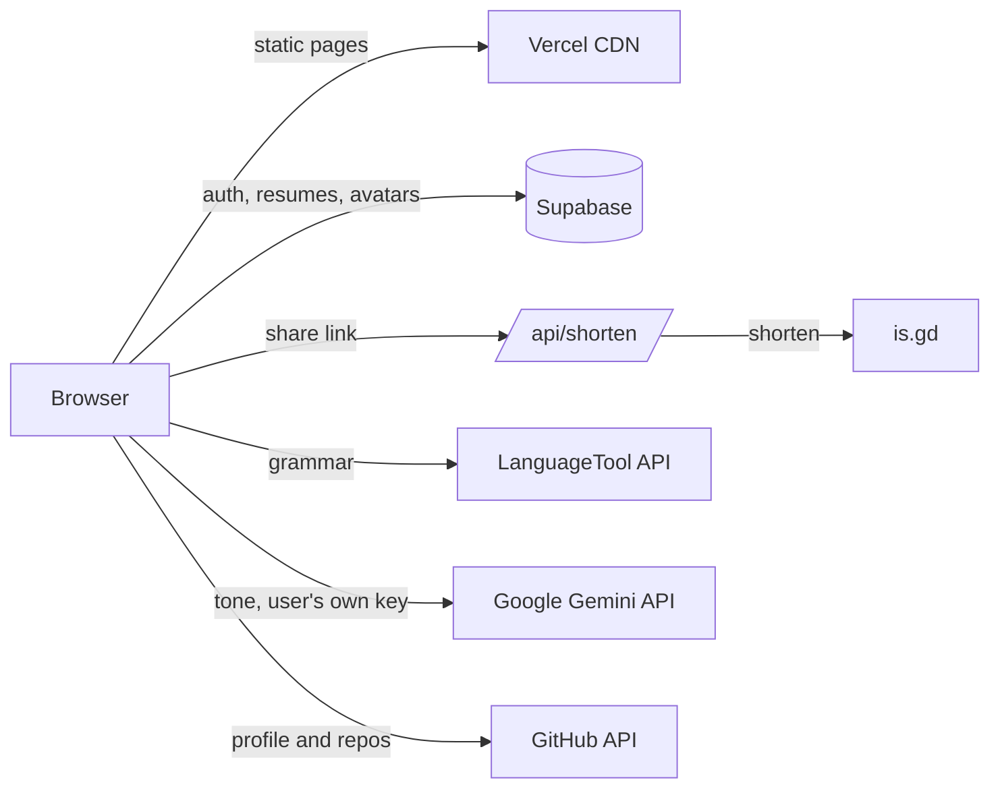

# Taimur Resume

A free, browser-based resume builder with a live preview, 15 Europass-format templates, cloud save, keyword-based ATS scoring, grammar and tone checking, GitHub import, and shareable links with QR codes.

**Live site:** [taimur-resume.vercel.app](https://taimur-resume.vercel.app)

---

## Features

### Building the resume
- **Live split-view preview.** The resume re-renders as you type, next to the form.
- **15 Europass-format templates.** One EU-recognized structure in three layouts and 15 looks:
  - *Sidebar:* Aurora, Emerald, Slate, Coral, Ivory
  - *Banner:* Sunrise, Horizon, Blossom, Nordic, Velvet
  - *Timeline:* Pulse, Meridian, Zenith, Canvas, Quartz
- **Matching accent colours.** Each template sets its own heading, rule and link colour to fit its palette.
- **Guided sections:** personal info, experience, education, skills, projects and achievements, with a sidebar progress tracker.
- **Language skills on the CEFR scale.** Each language is rated A1–C2 for listening, reading, speaking and writing, and mother tongues are listed separately, matching the Europass CV language grid.
- **Custom sections** such as Certifications, Volunteering, Publications or Awards, with one-click presets.
- **Skill suggestions** based on the job title (for example a Frontend Developer is offered React, TypeScript and accessibility), plus four clear skill levels.
- **Writing help:** tips and character counters on longer fields, and cards that title themselves (e.g. "Software Engineer · Google") and can be collapsed.
- **Drag-and-drop ordering** of sections (SortableJS).
- **Field validation** for email, phone and URL, shown on blur without blocking input.

### Smart tools
- **ATS keyword score.** Paste a job description to see what percentage of its keywords appear in your resume, plus a list of missing terms. Instant, and runs entirely in the browser.
- **AI job match.** Google Gemini compares the resume with the job by meaning rather than exact words (so "JS" counts as "JavaScript"), gives a match score, lists what matches and which required skills are missing, and rewrites up to three weak bullet points for that job. It is told never to invent experience: where a number would help, it leaves a placeholder such as `[X%]` for the user to fill in.
- **Grammar check** through the public [LanguageTool](https://languagetool.org) API (no key needed).
- **Tone analysis** through Google Gemini.
- **Improve with AI** on any experience or project description: Gemini rewrites it into 2–4 strong bullet points using only the user's facts, shown as a suggestion to accept or dismiss.
- Both Gemini tools use the user's own free API key, stored only in their browser. Busy or rate-limited requests are retried with exponential backoff and then fall back to a lighter model.
- **GitHub import.** Enter a username to fill in name, bio, location and website, and add up to five top non-fork repositories as projects.

### Accounts and cloud save
- **Email sign-up with a one-time code**, then a password (Supabase Auth).
- **Automatic cloud sync** while signed in, plus a manual *Save to Cloud* button.
- **My Resumes:** keep several resumes, then rename, duplicate, load or delete them.
- **Account settings:** display name, phone, profile photo and password change.
- **Demo mode** for signed-out visitors. Nothing is stored, so no data is left behind on shared computers.

### Export and sharing
- **PDF download** as paginated A4 (html2canvas + jsPDF), with browser print as a fallback.
- **JSON export and import** for backups.
- **Shareable link and QR code.** The resume is compressed into the URL itself (lz-string), so no server stores shared resumes. The link is shortened through a small serverless function.

---

## Tech stack

| Layer | Technology |
|---|---|
| Front end | HTML5, CSS3, vanilla JavaScript (no framework or build step) |
| Auth, database, file storage | [Supabase](https://supabase.com) (PostgreSQL, Auth, Storage) |
| Serverless API | Vercel Serverless Functions (Node.js) |
| Hosting | [Vercel](https://vercel.com), auto-deployed from `main` |
| AI and language | Google Gemini API, LanguageTool API |
| Libraries | SortableJS, html2canvas, jsPDF, lz-string, qrcode.js, Font Awesome, Google Fonts |

---

## Architecture



Most of the app runs in the browser. The only server code is `api/shorten.js`, which proxies is.gd to avoid CORS errors and accepts only `http`/`https` URLs, so it cannot be used as an open proxy.

---

## Project structure

```
├── index.html              Landing page
├── resume.html             The builder (form, preview, modals)
├── view.html               Read-only page for shared resume links
├── api/
│   └── shorten.js          Serverless URL shortener (is.gd proxy)
├── assets/
│   ├── css/main.css        App and template styles
│   └── js/
│       ├── app.js          Form state, live preview, templates, JSON import/export
│       ├── auth.js         Sign-up/sign-in, cloud save, My Resumes, account settings
│       ├── ai-tools.js     ATS keyword score, AI job match, grammar and tone checks
│       ├── github-import.js
│       ├── pdf-export.js
│       ├── share.js        Link compression, shortening, QR code
│       └── supabase-config.js
└── vercel.json
```

---

## Running locally

1. Clone the repository:
   ```bash
   git clone https://github.com/Taimur-Soft/taimur-resume.git
   cd taimur-resume
   ```
2. Serve the folder with any static server, for example:
   ```bash
   npx serve .
   ```
3. To run the URL-shortener function locally as well, use the Vercel CLI instead:
   ```bash
   npx vercel dev
   ```

Without the function, sharing still works: the app falls back to the full-length link.

### Supabase setup (for your own instance)

Put your project URL and anon key in `assets/js/supabase-config.js`, then create:

- a **`resumes`** table with `id`, `user_id` (references `auth.users`), `name` (text), `data` (jsonb) and `updated_at` (timestamptz);
- Row Level Security policies so each user can only read and write their own rows;
- a public **`avatars`** storage bucket for profile photos.

Email sign-up uses Supabase's one-time code (OTP) emails, so enable email OTP in the Auth settings.

---

## Security and privacy

- **XSS protection.** Resume data can arrive from untrusted shared links, so every field is HTML-escaped before rendering. Links are limited to `http`, `https` and `mailto`, and images to `https` or local `data:image` URLs.
- **No leftover local data.** Resumes are never kept in `localStorage`; signed-out sessions start blank, and data from older versions is purged on load.
- **Keys stay with the user.** The Gemini API key is stored only in the user's own browser and sent only to Google.
- **Shared links are self-contained.** The resume lives in the link itself, not on a server.

---

## Author

**Taimur Rahman**, university final-year project.

© Taimur Rahman Org. All rights reserved.
